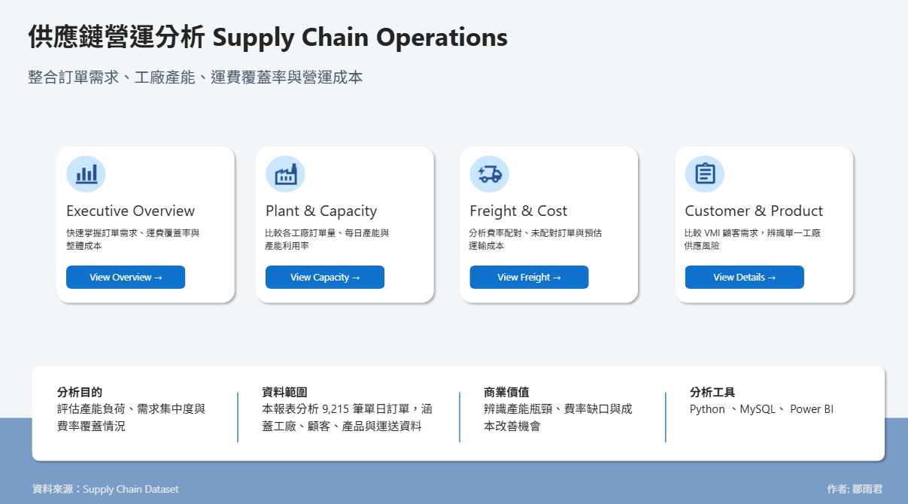
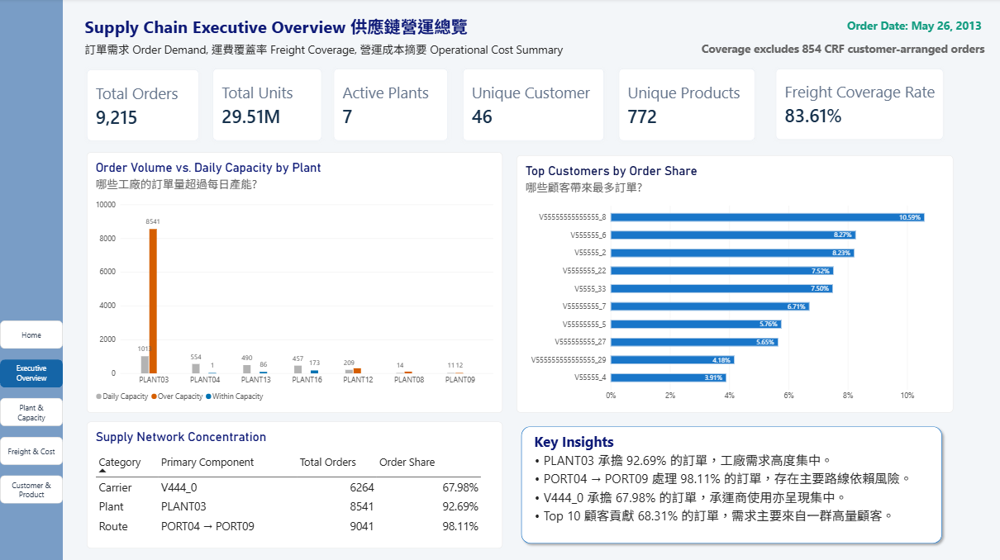
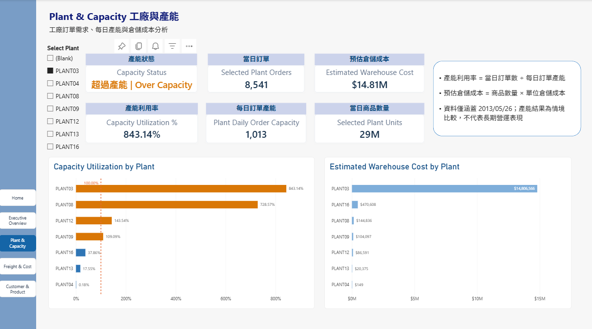
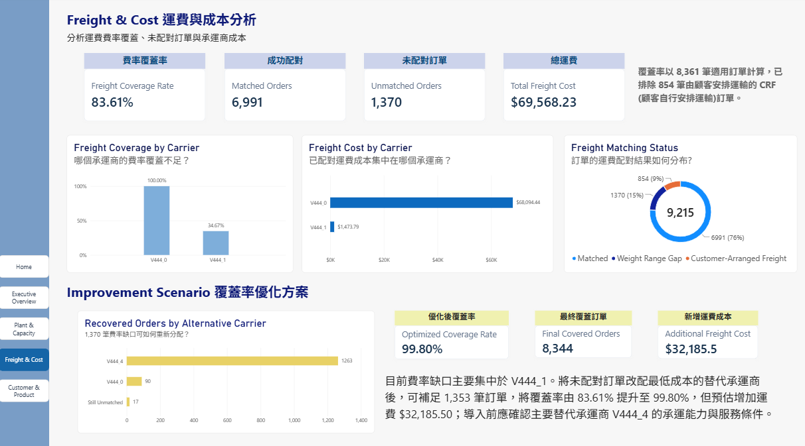
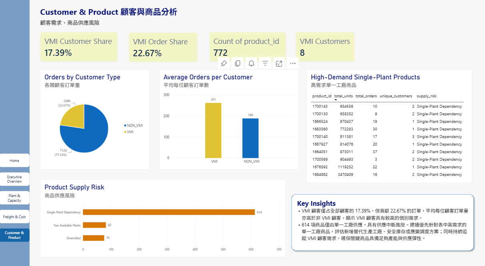

# supply-chain-analytics

End-to-end supply chain analytics project using SQL, Python, MySQL, and Power BI.

## Power BI Dashboard

[View Interactive Power BI Dashboard](https://app.powerbi.com/view?r=[你的完整連結](https://app.powerbi.com/view?r=eyJrIjoiOTliOGQwMDQtYTdjYi00YjQ0LThmZjgtZjcwYzM4M2JkZTJmIiwidCI6ImQ1N2QzMmNjLWMxMjEtNDg4Zi1iMDdiLWRmZTcwNTY4MGM3MSIsImMiOjN9))

> The dataset contains historical orders from May 26, 2013. Freight coverage excludes 854 customer-arranged CRF orders.

## Dashboard Preview

### Home Page

  

<table>
  <tr>
    <th>Executive Overview</th>
    <th>Plant &amp; Capacity</th>
  </tr>
  <tr>
    <td>
      
    </td>
    <td>
      
    </td>
  </tr>
  <tr>
    <th>Freight &amp; Cost</th>
    <th>Customer &amp; Product</th>
  </tr>
  <tr>
    <td>
      
    </td>
    <td>
      
    </td>
  </tr>
</table>
