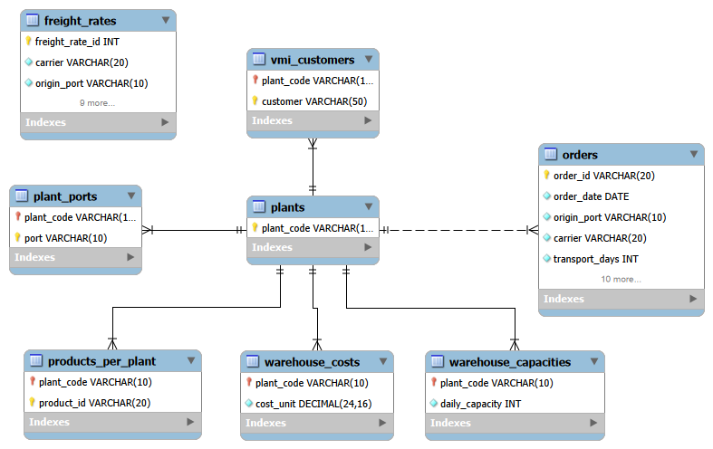

# Supply Chain Analytics｜供應鏈營運分析

本專案使用 Python、MySQL、SQL 與 Power BI 建立端到端供應鏈分析流程，將原始訂單、工廠、商品、顧客、倉儲成本與運費費率資料，轉換成可支援營運決策的分析結果與互動式報表。

分析重點包括工廠產能、顧客需求集中度、商品供應風險、運費費率覆蓋率，以及替代承運商改善方案。

---

## Business Problem｜商業問題

供應鏈營運資料分散在訂單、工廠、商品、費率與倉儲成本等多張資料表中，管理人員難以快速回答以下問題：

1. 哪些工廠的訂單需求超過每日處理產能？
2. 顧客需求是否集中於少數主要顧客？
3. VMI 顧客是否具有較高的個別訂單需求？
4. 哪些商品僅由單一工廠供應，具有供應中斷風險？
5. 有多少訂單能成功配對目前承運商的運費費率？
6. 未配對訂單能否改由其他承運商承接？
7. 提升費率覆蓋率需要增加多少預估運費？

本專案的目標是建立一致的資料模型與分析指標，協助管理人員辨識產能限制、需求集中及運輸費率缺口。

---

## Executive Summary｜重點摘要

本專案分析 **2013-05-26 單日共 9,215 筆訂單**，涵蓋 **46 位顧客、772 項商品及 7 間實際處理訂單的工廠**。

主要發現：

- **工廠產能：** 4 間工廠的當日訂單量超過每日處理容量，其中 PLANT03 承接 92.69% 的訂單，產能利用率達 843.14%。
- **顧客需求：** 前 10 大顧客貢獻 68.31% 的訂單；8 位 VMI 顧客占全部顧客的 17.39%，但貢獻 22.67% 的訂單。
- **商品供應：** 614 項商品僅由單一工廠供應，占全部商品的 79.53%，顯示供應來源高度集中。
- **費率覆蓋：** 排除 854 筆顧客自行安排運輸的 CRF 訂單後，現有承運商成功配對 6,991 筆 DTD 訂單，費率覆蓋率為 83.61%。
- **改善方案：** 使用最低成本的可行替代承運商，可再補足 1,353 筆訂單，使費率覆蓋率提升至 99.80%，但預估增加 $32,185.50 運費。

> Freight coverage is calculated using 8,361 DTD orders that require company-arranged transportation. The 854 CRF customer-arranged orders are excluded from the coverage denominator.

---

## Power BI Dashboard

[View Interactive Power BI Dashboard](https://app.powerbi.com/view?r=eyJrIjoiOTliOGQwMDQtYTdjYi00YjQ0LThmZjgtZjcwYzM4M2JkZTJmIiwidCI6ImQ1N2QzMmNjLWMxMjEtNDg4Zi1iMDdiLWRmZTcwNTY4MGM3MSIsImMiOjN9)

> The dataset contains historical orders from May 26, 2013. Freight coverage excludes 854 customer-arranged CRF orders.

## Dashboard Preview
<table>
  <tr>
    <th>Home Page</th>
    <th>Executive Overview</th>
    <th>Plant &amp; Capacity</th>
  </tr>
  <tr>
    <td>
      
    </td>
    <td>
      
    </td>
    <td>
      
    </td>
  </tr>
  <tr>
    <th>Freight &amp; Cost</th>
    <th>Customer &amp; Product</th>
    <th></th>
  </tr>
  <tr>
    <td>
      
    </td>
    <td>
      
    </td>
    <td></td>
  </tr>
</table>

---

## Recommendations｜營運建議

根據分析結果，提出以下建議：

1. 優先檢視超過每日訂單處理容量的工廠，評估訂單重新分配、臨時加班或產能擴充。
2. 持續追蹤 VMI 顧客與主要顧客的需求，確保關鍵商品具備足夠產能。
3. 優先為高需求且僅由單一工廠供應的商品建立替代生產來源或安全庫存。
4. 補齊費率覆蓋率較低的承運商與路線資料，降低未配對訂單數。
5. 導入替代承運商前，應確認其承運能力、服務等級、運輸時間與合約條件。
6. 同時評估費率覆蓋率與新增運費，避免只追求覆蓋率而忽略成本影響。

---

## Dataset｜資料來源

資料來源：

[Supply Chain Data – Kaggle](https://www.kaggle.com/datasets/laurinbrechter/supply-chain-data)

原始資料包含 7 張資料表：

| Table | Description |
|---|---|
| `orders` | 訂單、顧客、商品、工廠、承運商及運輸資訊 |
| `freight_rates` | 承運商、路線、服務等級、重量區間及費率 |
| `plant_ports` | 工廠與出貨港口配置 |
| `products_per_plant` | 商品可由哪些工廠供應 |
| `vmi_customers` | VMI 顧客與指定工廠配置 |
| `warehouse_capacities` | 各工廠每日訂單處理容量 |
| `warehouse_costs` | 各工廠單位倉儲成本 |

由於不同來源表涵蓋的工廠集合不同，本專案另外建立 `plants` 維度表，統一管理工廠代碼及 Foreign Key 關係。

---

## Data Model｜資料模型

資料模型以 `orders` 作為主要 Fact Table，並使用工廠、商品、顧客、費率及倉儲資料支援分析。

### Fact Table

- `orders`

### Dimension and Reference Tables

- `plants`
- `plant_ports`
- `products_per_plant`
- `vmi_customers`
- `warehouse_capacities`
- `warehouse_costs`
- `freight_rates`

`freight_rates` 未使用單一欄位 Foreign Key 直接連接 `orders`，因為費率必須同時依照以下條件配對：

- Carrier
- Origin port
- Destination port
- Service level
- Transportation days
- Minimum weight
- Maximum weight

因此，訂單與費率之間屬於多欄位商業配對規則，而不是簡單的一對多外鍵關係。

### Entity Relationship Diagram



---

## Analysis Workflow｜分析流程

```text
Raw CSV Files
      ↓
Python Data Profiling
      ↓
Python Data Cleaning
      ↓
Cleaned CSV Files
      ↓
MySQL Database
      ↓
SQL Constraints and Analytical Views
      ↓
Power BI Dashboard
```

### 1. Data Profiling

使用 Python 與 pandas 檢查：

- 資料筆數與欄位型態
- 缺失值與重複資料
- 主鍵候選欄位
- 複合唯一鍵
- 工廠代碼與參照完整性
- 字串格式與前後空白
- 異常數值與資料型態問題

### 2. Data Cleaning

主要清理內容包括：

- 將欄位名稱統一為 `snake_case`
- 標準化顧客、工廠、承運商與港口代碼
- 去除字串前後空白並統一大小寫
- 將 `order_date` 轉換為日期型態
- 將數量、重量、費率及成本轉換為數值型態
- 將 `order_id` 與 `product_id` 保留為字串，避免識別碼在轉型時失真
- 驗證清理前後的資料筆數

### 3. Database Modeling

將清理後的 CSV 載入 MySQL，並建立：

- Primary Keys
- Foreign Keys
- Composite Keys
- Data validation queries
- Analytical Views

### 4. SQL Analysis

SQL 分析內容包括：

- 工廠每日產能利用率
- 顧客訂單與商品需求占比
- VMI 與非 VMI 顧客比較
- 預估倉儲成本
- 運費費率配對
- 承運商費率覆蓋率
- 替代承運商改善方案
- 商品單一工廠依賴風險

### 5. Power BI Reporting

Power BI 主要連接 SQL Views，而不是直接連接所有原始表，使報表使用方式更接近企業中的 Data Mart 架構。

---

## SQL Views｜分析資料層

| View | Purpose |
|---|---|
| `vw_order_freight_detail` | 提供訂單層級的費率配對狀態與預估運費 |
| `vw_plant_performance` | 彙總工廠訂單量、每日容量、利用率及預估倉儲成本 |
| `vw_customer_concentration` | 分析顧客訂單占比、商品數量占比及 VMI 類型 |
| `vw_freight_optimization` | 比較目前承運商與最低成本替代承運商方案 |
| `vw_product_supply_risk` | 分析商品需求、可供應工廠數及供應風險 |

這些 Views 將複雜的 Join 與商業邏輯保留在 SQL 層，讓 Power BI 專注於指標計算、互動與視覺呈現。

---

## Freight Matching Logic｜費率配對邏輯

訂單必須同時符合以下條件才能成功配對費率：

```sql
o.carrier = f.carrier
AND o.origin_port = f.origin_port
AND o.destination_port = f.destination_port
AND o.service_level = f.service_level
AND o.transport_days = f.transport_days
AND o.weight >= f.min_weight
AND o.weight <= f.max_weight
```

若同一筆訂單符合多筆費率，則保留最低成本的可行費率，確保最後每筆訂單只產生一筆結果，避免 Join 造成訂單重複計算。

CRF（Customer-Arranged Freight）訂單由顧客自行安排運輸，因此不納入公司費率配對與覆蓋率的分母。

---

## Metric Definitions｜指標定義

### Capacity Utilization

```text
Capacity Utilization
= Daily Order Count ÷ Daily Order Capacity
```

`daily_capacity` 代表每日可處理的訂單數，而不是商品件數。

### Estimated Warehouse Cost

```text
Estimated Warehouse Cost
= Unit Quantity × Warehouse Cost per Unit
```

### Current Freight Coverage

```text
Current Freight Coverage
= Current Matched DTD Orders ÷ Applicable DTD Orders
= 6,991 ÷ 8,361
= 83.61%
```

### Optimized Freight Coverage

```text
Optimized Freight Coverage
= Orders Covered by Current or Alternative Carrier
  ÷ Applicable DTD Orders
= 8,344 ÷ 8,361
= 99.80%
```

### Freight Cost Scenario

```text
Current Matched Freight Cost       $69,568.23
Additional Alternative Freight     $32,185.50
Final Scenario Freight Cost       $101,753.73
```

此改善方案會增加費率覆蓋率，但同時增加預估運費，因此應視為 Coverage Improvement Scenario，而不是單純的成本最佳化。

---

## Validation Results｜交叉驗證結果

Python EDA、SQL 查詢與 Power BI 指標使用相同的基礎筆數進行交叉驗證：

| Metric | Result |
|---|---:|
| Total Orders | 9,215 |
| Total Units | 29,513,315 |
| Unique Customers | 46 |
| Unique Products | 772 |
| Active Plants | 7 |
| VMI Customers | 8 |
| CRF Orders | 854 |
| Applicable DTD Orders | 8,361 |
| Current Matched Orders | 6,991 |
| Current Coverage Rate | 83.61% |
| Current Freight Cost | $69,568.23 |
| Alternative Orders Recovered | 1,353 |
| Final Covered Orders | 8,344 |
| Optimized Coverage Rate | 99.80% |
| Still Unmatched DTD Orders | 17 |
| Additional Freight Cost | $32,185.50 |

完整的資料探索與分析圖表請參考：

[`03_eda.ipynb`](notebooks/03_eda.ipynb)

## Tools and Technologies｜使用工具

| Category | Tools |
|---|---|
| Data Analysis | Python, pandas, NumPy |
| Visualization | Matplotlib, Seaborn |
| Database | MySQL 8.0 |
| SQL Client | MySQL Workbench |
| Business Intelligence | Power BI Desktop, DAX, Power Query |
| Data Modeling | ERD, Primary Key, Foreign Key, SQL Views |
| Version Control | Git, GitHub |
| Development Environment | Jupyter Notebook, Google Colab, VS Code |

---

## Challenges and Solutions｜實作挑戰

### Different Plant Coverage

`plant_ports`、`warehouse_capacities` 與 `warehouse_costs` 涵蓋的工廠集合不同，因此不能直接使用其中一張來源表作為所有工廠的主表。

**Solution:** 建立獨立的 `plants` 維度表，整合所有來源中的工廠代碼。

### Multi-Column Freight Matching

訂單與費率之間沒有單一欄位可以直接連接。

**Solution:** 使用承運商、港口、服務等級、運輸天數與重量區間完成多條件配對。

### Duplicate Freight Matches

部分訂單可能同時符合多筆費率，直接 Join 會使同一筆訂單重複出現。

**Solution:** 對候選費率進行排序並保留最低成本方案，維持一筆訂單一列。

### CRF Coverage Definition

若將 CRF 訂單放入費率覆蓋率分母，會低估公司負責安排運輸訂單的實際覆蓋率。

**Solution:** 排除 854 筆顧客自行安排運輸的 CRF 訂單，只使用 8,361 筆 DTD 訂單計算覆蓋率。

### Historical VMI Configuration

歷史訂單使用的工廠與目前 VMI 配置不一定屬於相同期間。

**Solution:** VMI 分析僅判斷顧客是否存在目前 VMI 名單中，不將歷史工廠配置差異直接判定為錯誤。

---

## Limitations｜分析限制

- 訂單資料僅涵蓋 2013-05-26，無法分析長期趨勢、季節性或需求預測。
- `ship_ahead_day_count` 與 `ship_late_day_count` 缺乏完整商業定義，因此未直接解讀為可接受或不可接受的延遲。
- `transport_days` 代表設定的運輸時間，不是實際送達時間。
- VMI 表可能代表目前配置，而訂單屬於歷史資料，兩者不一定適用於相同期間。
- 運費結果依費率表估算，不代表實際帳單金額。
- 替代承運商方案只驗證資料中的費率條件，未包含承運能力、即時容量與合約限制。
- 本專案為作品集分析，結果不代表真實公司的正式營運決策。

---

## Future Improvements｜後續改善

- 加入多日期訂單資料，分析需求趨勢與季節性
- 建立需求預測與產能預警模型
- 加入承運商準時率及服務品質指標
- 建立商品安全庫存與缺貨風險模型
- 將 MySQL 部署至雲端資料庫
- 使用 dbt 管理資料轉換、測試與文件
- 建立 Power BI 自動資料更新流程

---

## Author

**Yujiun Zou**

MS in Business Analytics, Boston University

Focus: Data Analytics, SQL, Power BI, and Data pipeline Development


